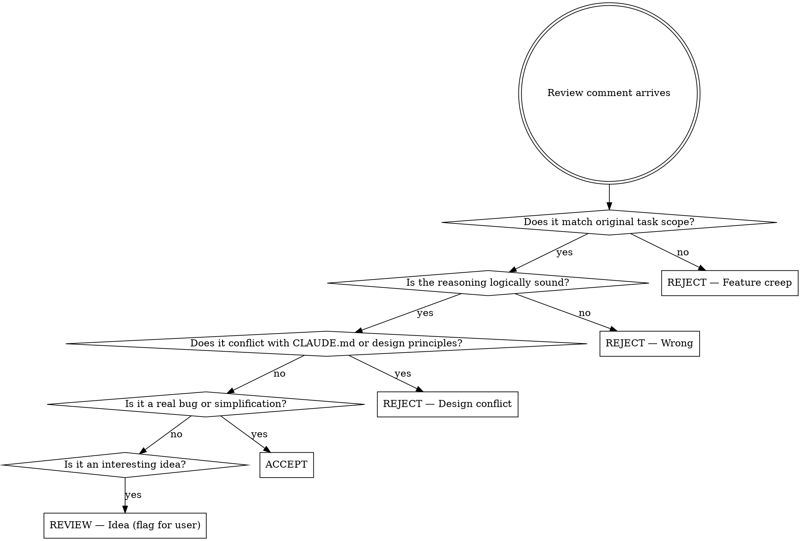

# Vet Reviews

## Overview

**Core principle:** External reviewers lack project context. Every review comment must be vetted against the codebase, design principles, and docs before any implementation begins. You are the final filter — not a rubber stamp.

This skill runs in two phases:
1. **Vetting phase** — Research, evaluate, and recommend. No code changes yet.
2. **Implementation phase** — After user approves recommendations, implement accepted items only.

---

## Phase 1: Vetting

### Step 1 — Gather Context First

Before reading a single review comment, load context:

- Read `CLAUDE.md` and any referenced docs
- Read the files the review touches
- Understand the feature's intent and design constraints
- Note any active architectural principles (e.g. SQLite over JSON, no backward compat shims)

**Do not skip this step.** Vetting without context produces bad recommendations.

### Step 2 — Dispatch Parallel Sub-Agents (One Per Comment)

Once context is loaded, dispatch **one sub-agent per review comment** in parallel. Each sub-agent receives:

1. The review comment text (verbatim)
2. The relevant file contents (only the touched files)
3. The architectural constraints from CLAUDE.md (summarised inline — do not link; sub-agents can't follow links)
4. The verdict taxonomy below
5. The self-exploration instruction: *"While evaluating this comment, apply your own critical eye to the same code. Report any issues the reviewer missed as NEW FINDING items."*

**Verdict taxonomy to pass to each sub-agent:**

| Verdict | When to use |
|---------|-------------|
| **ACCEPT — Bug** | Reviewer found a real defect: wrong logic, broken edge case, missing guard |
| **ACCEPT — Simplification** | Reviewer found a genuinely simpler or cleaner way; no scope expansion |
| **REJECT — Feature creep** | Comment asks for new behavior not in the original task |
| **REJECT — Wrong** | Comment is factually or logically incorrect; provide counter-reasoning |
| **REJECT — Design conflict** | Comment contradicts CLAUDE.md, established patterns, or architectural principles |
| **REVIEW — Idea** | Out-of-the-box suggestion worth discussing; flag for user decision |

**Sub-agent prompt template:**

```
You are evaluating one review comment on behalf of the lead reviewer.

## Comment to evaluate
[paste comment verbatim]

## Files touched
[paste relevant file contents]

## Architectural constraints
[paste key CLAUDE.md constraints inline — no file links]

## Your task
1. Assign one verdict from the taxonomy below (paste taxonomy).
2. Write an Assessment: cite specific lines/patterns in the code or constraints that support your verdict.
3. Self-exploration: While reading the code, note any issues the reviewer missed. Report each as a NEW FINDING with severity (High/Medium/Low).

## Output format
**Verdict:** <verdict>
**Reviewer said:** <paraphrase>
**Assessment:** <reasoning>
**New Findings:** <list or "None found.">
```

**Model selection per sub-agent:**
- **Haiku** — comment is a simple style/naming/formatting note with no architectural implications
- **Sonnet** (default) — comment touches logic, design patterns, or requires reading non-trivial code

### Step 3 — Collect and Assemble Report

Collect all sub-agent results. Merge NEW FINDING items (deduplicate if multiple sub-agents caught the same issue). Produce the consolidated Vetting Report (see format below).

Do **not** implement anything yet. Wait for user feedback.

---

## Report Format

```
## Vetting Report: [feature/PR name]

### Context Summary
[2–3 sentences: what the code does, key design constraints observed]

---

### Comment-by-Comment Verdicts

#### #1 — [Short title of comment]
**Verdict:** ACCEPT — Bug | ACCEPT — Simplification | REJECT — Feature creep | REJECT — Wrong | REJECT — Design conflict | REVIEW — Idea

**Reviewer said:** [paraphrase or quote]

**Assessment:** [Your reasoning — what you found in the code and docs that supports this verdict]

---

[repeat for each comment]

---

### New Findings (Self-Exploration)
[Any issues you found that the reviewer missed. If none, say "None found."]

#### NF1 — [Short title]
**Severity:** High | Medium | Low
**Finding:** [What you found and why it matters]

---

### Implementation Queue
[Only populated after user approves. Leave blank until then.]
```

---

## Phase 2: Implementation

**Only begin after user has reviewed the Vetting Report and confirmed which items to implement.**

- Implement ACCEPT items and any approved REVIEW — Idea items
- Implement NEW FINDING items the user approves
- Skip all REJECT items — do not add comments or stubs for them
- Follow TDD: write failing test first for each accepted item
- If an accepted edit changed an ExecPlan's milestones, Progress work items, Concrete Steps, or plan order, read `ExecPlan sync` in `.agents/skills/beads/SKILL.md` in the plan's repository and apply it. A code-only change does not. If that file is missing or `bd where` finds no tracker, skip it.

---

## Decision Flowchart



---

## Common Mistakes

| Mistake | Fix |
|---------|-----|
| Implementing before vetting is complete | Always finish the full report first |
| Accepting a comment because the reviewer sounds confident | Verify against code and docs — confidence ≠ correctness |
| Rejecting an idea without checking if it fits | Check CLAUDE.md before rejecting design suggestions |
| Skipping self-exploration | Always read the touched code; new findings often matter most |
| Treating REVIEW — Idea as automatic reject | These need user judgment, not your judgment |
